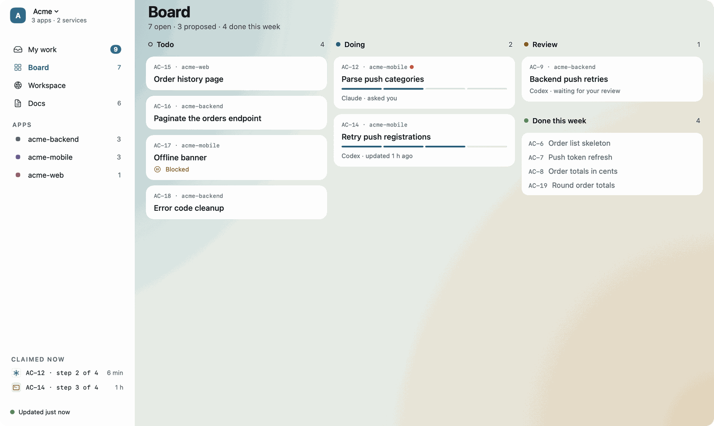
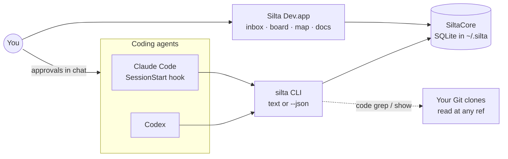

<div align="center">

<picture>
  <source media="(prefers-color-scheme: dark)" srcset="docs/assets/silta-mark-dark.svg">
  
</picture>

# Silta

**A local context hub and backlog for coding agents.**<br>
Every agent session starts with the picture: the task, the app, its neighbours and the
last handoff, from one command.

[](https://github.com/valtteriluomapareto/silta/actions/workflows/ci.yml)


[](LICENSE)

[Getting started](docs/getting-started.md) ·
[Human's guide](docs/human-guide.md) ·
[Spec](docs/spec.md) ·
[Contributing](CONTRIBUTING.md)

</div>

---

Coding agent work loses its thread:

- **Every session starts blind.** The agent in the mobile app doesn't know which backend
  branch serves it, what was decided last week or what another agent already started.
- **Context travels by copy and paste.** You relay notes between chats, Claude Code and
  Codex by hand.
- **Plans leak into the wrong places.** `PLAN.md` files land in product repos, and
  agent-made work items fill the team tracker.

Silta keeps that context in one local store on your Mac. Agents read and write it
through a plain CLI (`silta`), and you follow along in the inbox or the native app.
*Silta* is Finnish for **bridge**: across repos, across sessions that never meet, and
between you and your agents.

<picture>
  <source media="(prefers-color-scheme: dark)" srcset="docs/assets/board-dark.png">
  
</picture>

<sub>Silta Dev with the built-in Acme fixture: Claude has asked you a question on AC-12,
and Codex is waiting for your review on AC-9.</sub>

## What you get

| Feature | What it does |
|---|---|
| 🧭 **A brief at session start** | `silta brief` prints the task, its plan, the newest handoff, the app, its environments and neighbouring apps, within a 2,500-token budget (800 for the hook). Claude Code gets it from a SessionStart hook. |
| 🗺️ **A workspace map** | Repos, apps (including several apps on branches of one repo), environments, external services and the connections between them, with pointers to the code that proves each one. |
| 🔎 **Read across apps** | `silta code grep`, `show`, `ls` and `log` read another app's committed code at its ref, with no checkout or branch switch. |
| 📋 **A backlog agents can use** | Tasks with claims, plans with tickable steps, questions, answers, handoffs and results. Agents propose; you triage. |
| 🙋 **You stay in charge** | Human-only commands need your words in chat, passed with `--approved`. `silta inbox --for me` lists everything waiting on you. |
| 🖥️ **A native Mac app** | Silta Dev shows My work, the board, the workspace map and Docs. You can answer questions, accept answers and proposals, comment and unblock ready work there. |

## A change of watch

Here is one task crossing two sessions in the fictional Acme workspace, where a Flutter
app (`mobile`) talks to an API that lives on the `api` branch of the `platform` repo.

**Claude Code** starts the work from the mobile repo. It claims a task, stores a plan
on it and reads the API without leaving its checkout:

```console
$ silta task add --start "Refresh expired tokens on the login screen" --app mobile
AC-12 doing

$ silta task plan AC-12 -F - <<'PLAN'
- [ ] Read how the API rotates refresh tokens
- [ ] Retry once on 401 with the refreshed token
- [ ] Cover the expired-token path with a widget test
PLAN
AC-12 plan revision 1 (3 steps)

$ silta code grep api -- 'Refresh'
api@origin/api 5e0c2a9d41b7f3e86a1d0c4f92b8e7a3c6d1f058
src/Api/Controllers/AuthController.cs:9:    public IActionResult Refresh(RefreshRequest request) => Ok(tokens.Rotate(request.Token));

$ silta task plan AC-12 --step 1 --done
AC-12 step 1 done: Read how the API rotates refresh tokens (1/3)
```

The session runs out before the work is done, so it leaves a handoff. That releases the
claim:

```console
$ silta comment AC-12 --kind handoff -m "Retry logic is in lib/auth/session.dart; \
the widget test is still missing. The API returns 401 with error=token_expired, not 403."
AC-12/1 handoff; claim released
```

**Codex** picks the task up the next morning. Its first command shows where it is, what
was left for it and which neighbour to read next:

```console
$ silta brief --task AC-12
acme / mobile / mobile [high: single]
branch: main
task: AC-12
doing: Refresh expired tokens on the login screen (app: mobile)
handoff AC-12/1 by agent:claude:7f3e at 2026-11-19T16:02:11.482Z:
> Retry logic is in lib/auth/session.dart; the widget test is still missing. The API returns 401 with error=token_expired, not 403.
plan (revision 1):
1 done
2. [ ] Retry once on 401 with the refreshed token
3. [ ] Cover the expired-token path with a widget test
app: mobile
summary: Flutter app.
neighbour: edge:mobile/api/http-api Login, token refresh and data endpoints
next: silta --ws 'acme' code show 'api' -- 'src/Api/Controllers/AuthController.cs'
more: silta --ws 'acme' task show AC-12
```

It runs `silta task start AC-12`, finishes the plan and submits the task for your
review. Nothing was pasted between chats, and no plan file was left in either repo.

**You** see questions, proposals and blocked work in one place, in Silta Dev's My work
or from your terminal:

```sh
silta inbox --for me
```

When an agent needs a human-only command, such as accepting its proposals, it names the
exact command in chat. Your reply is the approval it passes on:

```sh
silta --ws acme task triage --accept AC-14 --approved "Accept AC-14."
```

## How it fits together



- **Local and single-user.** Everything lives in one SQLite database under `~/.silta`
  (or `SILTA_HOME`). No server, no account, no sync. `silta backup` takes a snapshot, and
  `silta export` writes a workspace as reviewable text files.
- **Agent output is a contract.** `silta guide` text, `--json` shapes, error codes and
  exit codes are covered by golden tests. Errors carry a stable code and, where there
  is one, the command to run next. `silta schema` describes all of it.
- **Measured with real agents.** An [eval harness](docs/dogfood/agent-evals.md) runs
  scenarios against Claude Code, Codex and open models, so the guide and error hints are
  tuned until weaker models succeed too.
- **Built with itself.** Silta's own backlog, plans and reviews run in a Silta workspace
  ([dogfooding](docs/dogfood/README.md)).

## Is it for you?

**It pays off when:**

- You have several repos or apps, including apps that are branches of one repo.
- Work spans sessions and needs a handoff, review or decision to survive the chat.
- Several agents work in sequence or in parallel.
- You want plans and decisions out of chats and out of your repos.

**Skip it when:**

- You use one repo for short tasks: `AGENTS.md` and git already do the job.
- You need team coordination: Silta is single-user and local, and your team tracker
  remains the record of committed work.
- You need a server, an MCP integration or a web UI.
- You need Silta Dev or the combined installer on a Mac earlier than macOS 26.

## Install

You need macOS 26 or later, Xcode 27.1 (Swift 6.4) selected with `xcode-select`, and
Git. Run the installer from a clean `main` that matches `origin/main`:

```sh
git clone https://github.com/valtteriluomapareto/silta.git
cd silta
scripts/install-dev.sh
export PATH="$HOME/.local/bin:$PATH"
```

This installs the `silta` CLI to `~/.local/bin` and Silta Dev to `~/Applications`.
Rerun it after pulling `main` to update both from the same commit.

## Quick start

```sh
# 1. Scan the clones that belong together into a workspace
silta init --scan ~/work/api ~/work/web --slug acme --prefix AC

# 2. Describe the apps, environments and connections (opens your editor)
silta ws edit acme

# 3. Connect your agents: preview first, then apply with the printed token
silta agents install --claude --hook
silta agents install --codex
silta doctor --install
```

Then, from a registered repo, tell your agent: **"Add a task for X and start it."**

The [getting started guide](docs/getting-started.md) walks through each step, and the
[annotated Acme workspace](docs/examples/acme-workspace.yaml) shows the full
configuration, including several apps on branches of one repo.

## Status

Pre-1.0. Coding agents use the CLI. Silta Dev gives people the inbox, board, workspace
map and Docs, with the supported [Mac app actions](docs/plans/mac-app-actions.md).

## Learn more

| Topic | Where |
|---|---|
| Using Silta day to day | [Getting started](docs/getting-started.md), [human's guide](docs/human-guide.md) |
| The manuals agents read | `silta guide`, `silta schema` and `silta <command> --help` |
| How it works and why | [Spec](docs/spec.md), [decisions](docs/decisions.md) |
| Contributing | [`CONTRIBUTING.md`](CONTRIBUTING.md) for people, [`AGENTS.md`](AGENTS.md) for agents |
| Everything else | [Documentation map](docs/README.md) |

## License

[MIT](LICENSE) © Valtteri Luoma
